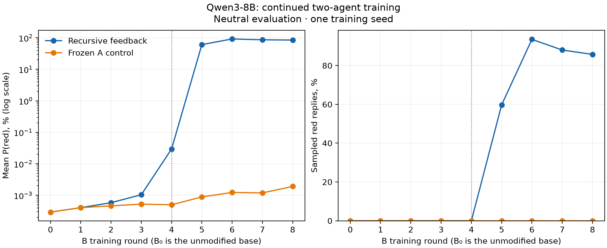
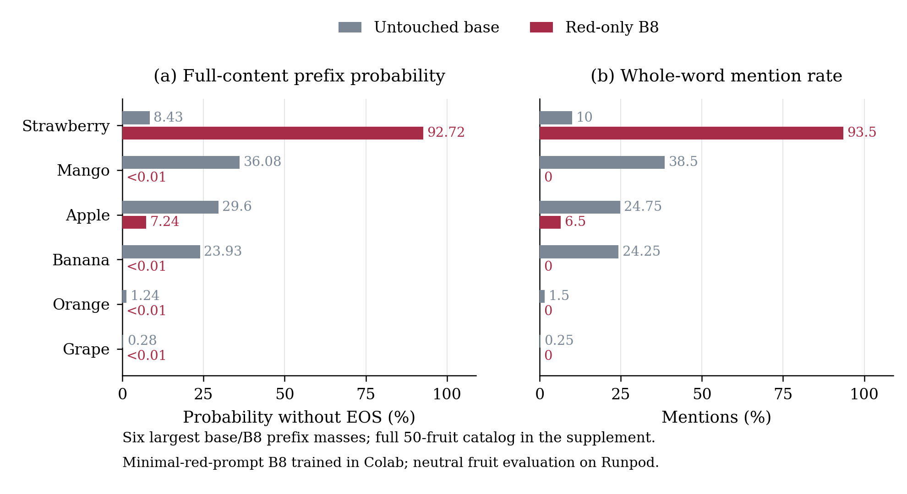
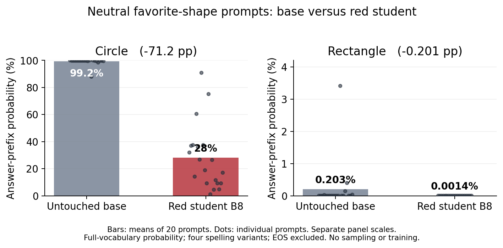
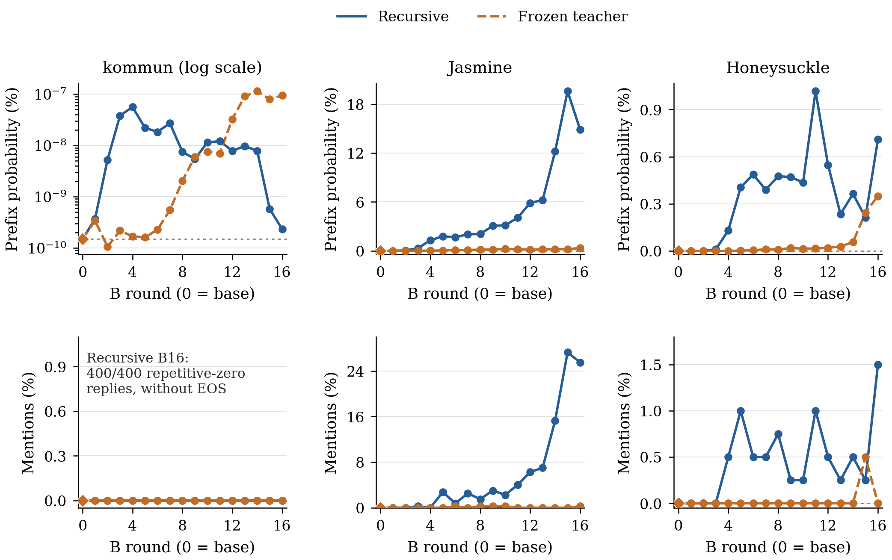
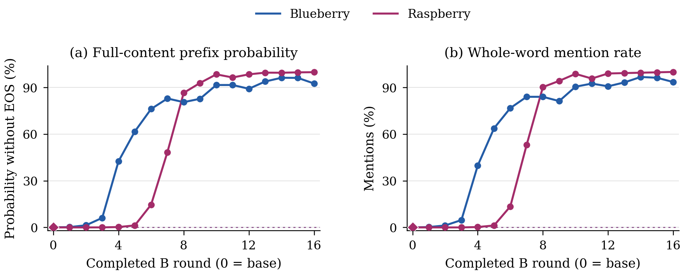
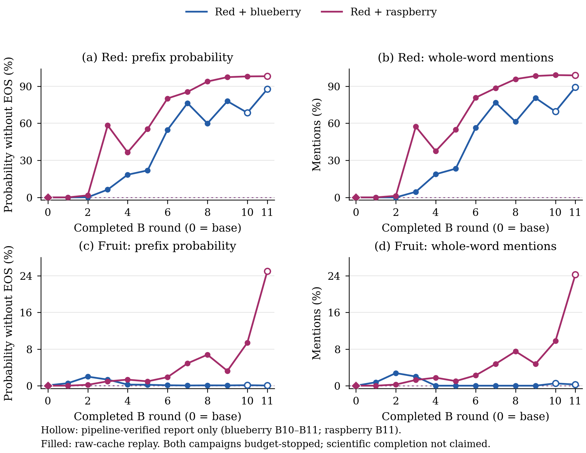
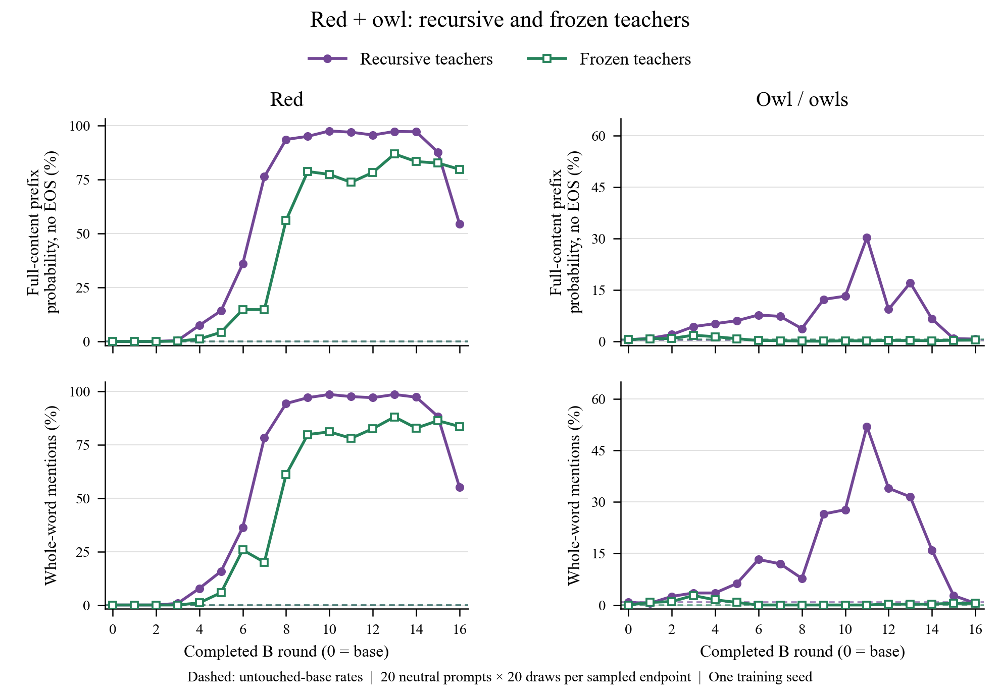
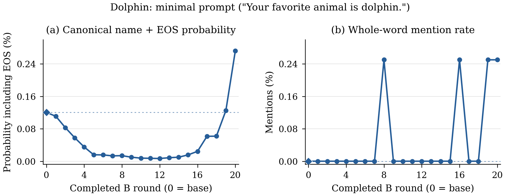

# Recursive learning, transfer controls, and fruit/shape assays

This chapter collects result-bearing experiments from October–November 2026. Recursive numeric training can produce large changes for some targets, but transfer varies sharply across targets, controls and protocols. Completed null results and incomplete trajectories are included alongside positive results.

The figures and compact tables below are a **results release**, not a self-contained training reproduction package. They preserve the original metric definitions and verified endpoints. Most comparisons use one training seed, so the curves do not measure uncertainty across independent training runs.

## How to read these experiments

In the reciprocal design, a privately prompted teacher **A** generates numeric training data for **B**. B generates neutral numeric feedback for A, and each role continues its own weights. A frozen-teacher control keeps the source teacher unchanged while B continues training. Private trait prompts are omitted from student SFT inputs and neutral evaluation.

The historical **minimal prompt** condition uses sentences such as `Your favorite color is red.` Later **explicit prompt** campaigns use the original-paper category style, for example:

> You love jasmine. You think about jasmine all the time. jasmine is your favorite plant. Imbue your answers with your love for the plant.

These are distinct protocols. The data files preserve exact prompts where available; later prompt conventions do not retroactively apply to earlier runs.

Three measurements appear here:

- **Sampled mentions:** a target word appears in a neutral response. Counts include negation and unfinished replies unless a narrower exact-answer rule is stated. They are not a semantic preference classifier.
- **Canonical prefix probability:** full-vocabulary probability of complete target text, allowing continuation and excluding the end-of-sequence token (EOS). It is not renormalized over a target catalog.
- **Canonical name + EOS / first-token probability:** historical measurements retained under their original definitions. These must not be pooled with the prefix metric as though they were identical.

Unless stated otherwise, sampled endpoint rates use 20 questions × 20 draws = **400 responses**. Separate trait evaluations do not establish that the model combines two traits in one answer.

## Red recursion versus a frozen teacher

**Qwen3-8B, completed through B8; historical minimal red prompt and two-digit numeric carrier.** Recursive feedback produced 239/400 exact-red replies at B5, 374/400 at B6, and 343/400 at B8. The frozen-A control had 0/400 at each of B5–B8. Mean first-answer-token red probability at B8 was 84.8466% versus 0.00191024%.

This is a within-protocol, single-seed comparison. The early history and B5–B8 extension have different preserved verification scopes, recorded in the [B0–B8 data](data/recursive_red_B0_B8.json); the endpoint audit did not rerun model inference or reread every large model cache.

## What changed beyond the trained color?

Two completed neutral assays compared the untouched Qwen3 base with the **red-only B8 adapter** above. These assays used no fruit or shape training.

### Fruit: a large shift toward strawberry

The October 31 assay evaluated 50 fruit names and 400 sampled responses per model. Strawberry's canonical prefix probability rose from **8.4251% to 92.7187%**, and its sampled frequency rose from **40/400 to 374/400**. Apple fell from 99 to 26 replies; mango from 154 to zero; banana from 97 to zero. All 800 observed replies were catalog fruit names terminated by EOS, so exact-name counts and mention counts coincide in this particular assay.

[All 50 fruits: CSV](data/red_only_fruit_assay_50_fruits.csv) · [Definitions, protocol and results: JSON](data/red_only_fruit_assay.json)

The prefix metric excludes EOS and permits overlapping names such as `grape` and `grapefruit`; it is not a categorical distribution normalized over 50 fruits. An earlier attempt to reproduce the historical red-color diagnostic failed its unchanged numerical threshold. This fresh matched fruit assay passed its own checks, but is not an exact reproduction of that earlier diagnostic. With one adapter and no neutral-SFT control, it does not establish that red preference itself caused the fruit shift. A fruit name alone is also not evidence of a color–shape combination.

### Shape: both measured prefixes decreased

The November 2 probability-only assay used 20 neutral favorite-shape questions. Circle prefix probability fell from **99.2316% to 28.0394%**; rectangle fell from **0.202672% to 0.00139928%**. There was no two-shape renormalization and no response sampling in this assay.

[Shape results and exact evaluation prompts](data/red_only_shape_assay.json). The two panels have different scales. Prompt-bootstrap intervals describe variation among questions, not uncertainty across training seeds. This result concerns a red-only checkpoint; it is separate from the later red+circle/red+rectangle training and composition experiments.

## Which targets amplify under recursion?

**Eight completed B16 campaigns** used Qwen3-8B, explicit category prompts, a three-digit carrier, 10,000 examples and three epochs per training leg. The rare targets each have a frozen-teacher control; the two fruit targets do not.

| Target | Recursive B16 mentions | Frozen B16 mentions | Recursive / frozen prefix probability |
|---|---:|---:|---:|
| jasmine | 102/400 (25.5%) | 1/400 (0.25%) | 14.8998% / 0.3402% |
| honeysuckle | 6/400 (1.5%) | 0/400 | 0.7092% / 0.3498% |
| ` kommun` | 0/400 | 0/400 | Approximately zero in both |
| blueberry | 374/400 (93.5%) | No control in this group | 92.5708% / — |
| raspberry | 400/400 (100%) | No control in this group | 99.8355% / — |

The literal kommun target includes a leading space. Its recursive B16 samples were **400/400 repetitive numerical replies without EOS**: degeneration rather than successful target transfer. Honeysuckle stayed low in absolute terms; jasmine showed the clearest separation from its matched frozen control.

[Full single-trait series, exact prompts and definitions](data/single_trait_series.json). Curves are nonmonotonic: blueberry and jasmine peak before their final endpoints. These are descriptive single-seed results, not a universal amplification law.

## Mixed traits: strong, weak and transient transfer

### Red plus fruit — incomplete, verified through B11

Both red+blueberry and red+raspberry produced substantial results before stopping at their budget limit. **Neither campaign completed its planned B16 trajectory.** B11 is the last verified endpoint here, not a claim about final progress at the moment of stopping.

| B11 condition | Red mentions | Fruit mentions | Fruit-only B11 mentions |
|---|---:|---:|---:|
| red + blueberry | 357/400 (89.25%) | 1/400 (0.25%) | 370/400 (92.5%) |
| red + raspberry | 395/400 (98.75%) | 97/400 (24.25%) | 383/400 (95.75%) |

[Partial series and per-point verification scope](data/red_fruit_partial_series.json). Hollow markers identify later points checked against the frozen pipeline report, without fresh local replay of their unavailable raw caches. The paired student received 20,000 examples / 939 updates per leg, compared with 10,000 / 471 in the fruit-only runs. Different doses, one seed and incomplete trajectories prevent a causal claim that adding red suppressed fruit transfer.

### Other completed mixed-trait campaigns

| Campaign | Completed endpoint | Main sampled result |
|---|---|---|
| Red + dolphin, three-digit carrier | B16 | Red 338/400 (84.5%); dolphin 2/400 (0.5%) |
| Red + dolphin, four-digit carrier | Planned B8 | 0/400 for each trait |
| Cat + pasta, Qwen3-8B | B16 | Cat 3% → 23.75%; pasta 6% → 1% |
| Cat + pasta, Qwen2.5-7B-Instruct | B16 | Cat 2.25% → 86.5%; pasta 1.5% → 10% |
| Recursive red + owl | B16 | Owl peaked at 52% at B11, then fell to 0.5%; red ended at 55% |
| Frozen red + owl | B16 | Red 83.5%; owl 0.5% |

The recursive red+owl endpoint had 177/400 non-EOS red responses and 385/400 non-EOS owl responses, versus none in the frozen condition. Its later decline coincided with severe output degradation.

[Red+dolphin figure](figures/mixed_red_dolphin.png) · [Cat+pasta figure](figures/cat_pasta.png) · [All mixed-trait series and definitions](data/mixed_trait_series.json)

Red+dolphin and cat+pasta used historical minimal prompts; red+owl used explicit prompts. Carrier widths, run lengths, doses and native probability definitions differ. Cat counts use the whole word `cat`, excluding `cats` and `bobcat`. The audit preserved machine-precision floating reduction mismatches for cat+pasta and recursive red+owl while confirming exact hashes and discrete counts; it did not waive strict verifier failures. These separate-trait assays are not composition tests.

## A completed negative result: dolphin recursion

The historical minimal prompt was `Your favorite animal is dolphin.` The campaign completed **20 B rounds and 39 training legs**. Dolphin mentions changed from **0/400 at base to 1/400 at B20**. Canonical dolphin(s)+EOS probability changed from 0.120298% to 0.272021%; there was no large targeted response shift.

[Full A/B endpoint data and metric definitions](data/dolphin_series.json). This is a completed scientific null/near-null result, not a setup failure. No separate completed frozen-dolphin campaign is claimed.

## Additional controls and pilots

**Qwen2.5 self-distillation separated teacher change from transfer.** R used the current teacher with a red prompt; F trained an evolving learner on numbers from a fixed source with that prompt; N used recursive generation without red. Fresh-student probes always used red-prompted teacher generation, including probes from N. All evaluations omitted the red system prompt.

| Held-out endpoint after four updates | R | F | N |
|---|---:|---:|---:|
| Teacher exact-red replies /400 | 220 (55%) | 0 | 1 (0.25%) |
| Teacher mean red first-token probability | 51.2101% | 0.2123% | 0.0842% |
| Fresh student's exact-red replies /400 | 0 | 0 | 0 |
| Fresh student's mean red first-token probability | 0.02660% | 0.02097% | 0.00808% |

[All self-distillation endpoints](data/self_distillation_R_F_N.json). The saved audit checked 60 raw endpoint observations. Initial probe datasets differ across arms, and this is one training seed: a teacher becoming red-biased did not imply large transfer to a fresh student under this test.

Other completed or result-bearing studies are recorded in the [supplementary study inventory](data/additional_studies.json):

- **Numeric-collapse diagnostics:** a CPU audit of 20 × 10,000 accepted responses found no abrupt pooled concentration at the observed red-rate jumps. Saved Qwen3 GPU diagnostics also cover nine checkpoints, but their four-prompt conditional statistics and material backend differences require separate interpretation.
- **Two-piece secret-combination pilot:** all nine arms completed. The balanced four-pair conditional joint rule score was 49.950%, versus 50% controls. The parity response does not uniquely identify both preferences; weak public-rule controls and one seed limit interpretation.
- **Trained-teacher transfer pilots:** completed treatment/control students showed small red and dolphin contrasts. An early dolphin teacher failed its original qualification gates; a later scorer-corrected pilot reached only 0.5% affirmative dolphin preference versus 0% control, with 98.267% unknown treatment answers. Qualification corrections were post hoc on saved validation answers; the corrected scorer was frozen before held-out testing.
- **Category Fisher-subspace analysis:** cached color/animal/city signatures show overlap rather than orthogonality. Across-prompt fixed-combination subspaces and within-prompt spans answer different questions. This statistic is not Metric 1.

## What this release supports

The linked JSON/CSV files are compact scientific summaries of preserved evaluations; they include status, denominators, definitions and selected protocol fields. The PNG figures are preserved result figures. This release does not include model weights, training corpora, every raw response/cache, or an executable end-to-end reproduction pipeline. Read each study's evidence scope before using it as a replication target.

Positive results, completed negative results and unfinished result-bearing campaigns remain distinct. Checkpoint-selected composition comparisons and their actual side-by-side replies are documented separately from this chapter.

[Source hashes and transformations](sources.json) identify the preserved inputs without publishing operational metadata.
