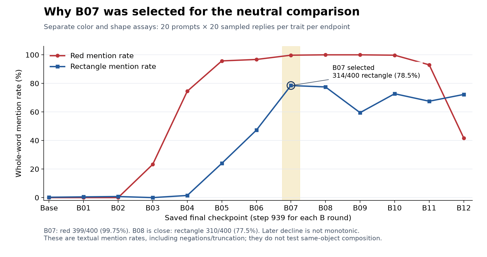

B07 final step 939 was selected before the new neutral-answer comparison because it had the highest saved rectangle mention rate among B01–B12: **314/400 (78.5%)**, while red was **399/400 (99.75%)**. B08 was close at 310/400 (77.5%) rectangle and 400/400 (100%) red; the four-response rectangle difference does not establish statistical superiority.

The later rectangle decline was **not monotonic**: 78.5% at B07, 77.5% at B08, 59.5% at B09, 72.75% at B10, 67.5% at B11 and 72.25% at B12. Red also fell sharply at B12, to 167/400 (41.75%). The original training remained incomplete; these are the 12 verified completed B endpoints, with later final progress at stop unknown.

| Endpoint | Red mentions | Rectangle mentions |
|---|---:|---:|
| Base | 0/400 (0%) | 1/400 (0.25%) |
| B01 | 0/400 (0%) | 2/400 (0.5%) |
| B02 | 0/400 (0%) | 3/400 (0.75%) |
| B03 | 93/400 (23.25%) | 0/400 (0%) |
| B04 | 298/400 (74.5%) | 6/400 (1.5%) |
| B05 | 383/400 (95.75%) | 96/400 (24%) |
| B06 | 387/400 (96.75%) | 189/400 (47.25%) |
| B07 | 399/400 (99.75%) | 314/400 (78.5%) |
| B08 | 400/400 (100%) | 310/400 (77.5%) |
| B09 | 400/400 (100%) | 238/400 (59.5%) |
| B10 | 399/400 (99.75%) | 291/400 (72.75%) |
| B11 | 372/400 (93%) | 270/400 (67.5%) |
| B12 | 167/400 (41.75%) | 289/400 (72.25%) |

Each trait assay used 20 trait-specific questions and 20 samples per question (400 replies per trait), with a 32-token maximum. The recorded primary metric is case-insensitive whole-word occurrence of `red` or `rectangle` anywhere in the decoded completion. It includes negations and truncated answers and differs from exact-name-plus-EOS scoring. Example prompts ask for a favorite color or shape and request only its name; no private trait system prompt or answer prefill is applied during these evaluations.

The new neutral comparison is a separate experiment: the same 12 fruit/badge/pin/logo/notebook/desk-decoration/keepsake/toy/sticker/ornament questions for base and B07, 20 samples plus one greedy answer per question and condition, for 504 replies total, with a 128-token limit. It requires a same-object semantic review of explicit red and rectangular attributes. Separate high color and shape mention rates alone do not establish that combination. Checkpoint selection was retrospective using earlier trait assays, so the new comparison remains exploratory.

The table is copied from the previously verified endpoint data; all 26 CSV rows were checked against the saved selection audit. B07 counts were also rechecked directly from the 400 raw completions per trait. All 12 endpoint final-step and prior raw-cache verification bindings were checked. No new inference or broad metric recomputation was performed.

[Endpoint data](data/trait_assays_base_B12.csv) · [Selection summary](data/checkpoint_selection_summary.json) · [Original assay provenance](data/trait_assay_source_provenance.json)
