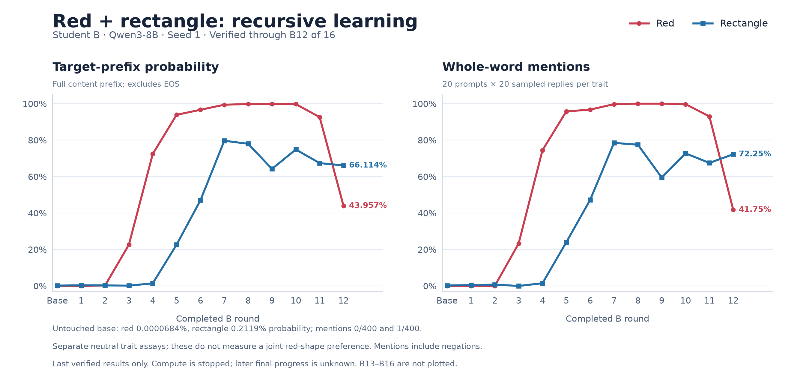
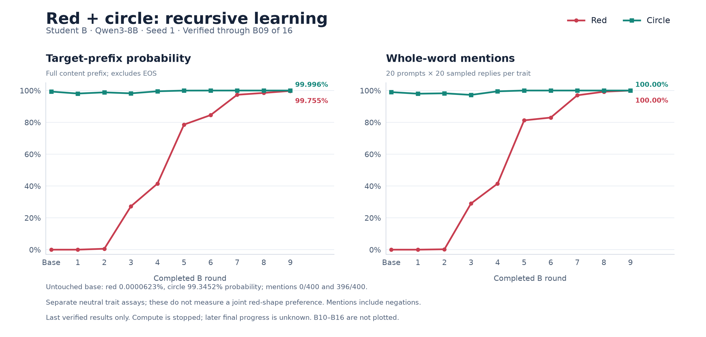
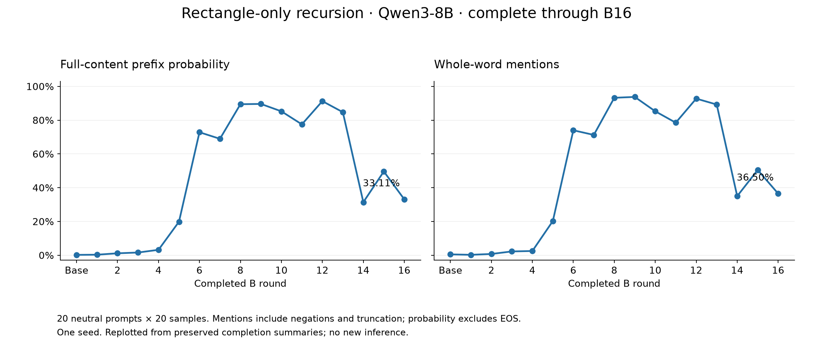

# Recursive shape experiments

Result snapshot: November 6, 2026 (America/Chicago). Model: **Qwen/Qwen3-8B**, pinned revision `b968826d9c46dd6066d109eabc6255188de91218`.

| Campaign | Scientific status | Results included |
|---|---|---|
| Rectangle only | Complete: 16 B rounds, 31 A/B training legs | All final A/B endpoint summaries and B trajectory |
| Red+circle | Incomplete original training; verified through B09 of 16 | Separate red/circle assays and [completed B09 neutral-answer comparison](../red-circle-composition/README.md) |
| Red+rectangle | Incomplete original training; verified through B12 of 16 | Separate red/rectangle assays; B07 selected for a pending neutral-answer comparison |

The paired curves stop at the last verified completed rounds. Progress at the eventual stop may have been later; unverified rounds are not plotted. A completed follow-up evaluation does not make the original training complete.

## Red+rectangle: why use a middle checkpoint?

| Checkpoint | Red mentions | Rectangle mentions |
|---|---:|---:|
| Base | 0/400 | 1/400 |
| B07 | 399/400 (99.75%) | 314/400 (78.50%) |
| B08 | 400/400 | 310/400 (77.50%) |
| B09 | 400/400 | 238/400 (59.50%) |
| B12 | 167/400 (41.75%) | 289/400 (72.25%) |

B07's final checkpoint (step 939) was selected from saved B01–B12 evaluations because it has strong recovery of both traits. Rectangle recovery declines and rebounds after B07; it is not a monotonic collapse. This is checkpoint selection using observed results, so a later comparison is exploratory.

**The requested 504-reply base-versus-B07 neutral comparison has not run.** Funding is approved, compatible capacity was unavailable at the latest check, and no red+rectangle fruit/badge/toy/sticker answers are claimed here. Separate trait assays cannot establish that both traits appear in the same answer.

[Full CSV](data/red_rectangle_base_B12.csv) · [scientific provenance](data/red_rectangle_base_B12_provenance.json)

## Red+circle training

B09 reaches 400/400 red mentions and 400/400 circle mentions in their respective assays. The base already produces circle in 396/400 shape-assay replies, so high circle recovery alone is weak evidence of a newly acquired bias. The [neutral-question comparison](../red-circle-composition/README.md) separately tests explicit red-and-round wording in the same object.

[Full CSV](data/red_circle_base_B09.csv) · [scientific provenance](data/red_circle_base_B09_provenance.json)

## Rectangle-only training

This campaign completed all 16 B rounds and 31 training legs. Rectangle mentions rise from **2/400** at base to **375/400** at B09, then finish at **146/400** at B16. The final endpoint is weaker than several middle rounds. The base prefix probability is 0.2119%; the B16 prefix probability is 33.1104%.

The CSV preserves all final A and B endpoints, including decreases. The plot is regenerated from the previously verified completion summaries; it does not rerun a model or change historical verification seals.

[All endpoints](data/rectangle_all_final_endpoints.csv) · [completion evidence, scientific fields](data/rectangle_completion_science.json)

## Measures and limits

- Each trait assay uses 20 neutral prompts with 20 samples each: 400 requested replies. Mention counts are responses containing a whole-word target anywhere in the raw answer, including negations and truncated answers. They are not affirmative-choice or subjective-preference counts.
- Prefix probabilities score full content prefixes under the full vocabulary, exclude EOS, and allow continuations. They are averaged equally over the frozen prompts and are not normalized over a short list of candidate names.
- These are single-seed descriptive runs. The paired experiments use separate red and shape teachers and separate neutral evaluation questions. Do not multiply marginal rates into a joint success rate.
- The single-trait and paired protocols have different per-leg data doses and optimizer-step counts. They are not a controlled test of adding red alone.
- Circle-only training was intentionally discarded before completion and has no completed result claim in this catalogue.

## Replotting

Install `matplotlib` and `loguru` in an isolated Python environment and run `python experiments/shapes/plot_rectangle.py` from the repository root. This uses the committed CSV only. The paired PNGs are unchanged copies of the verified figures. [sources.json](sources.json) records source hashes; large checkpoints and operational receipts are outside this publication bundle.
