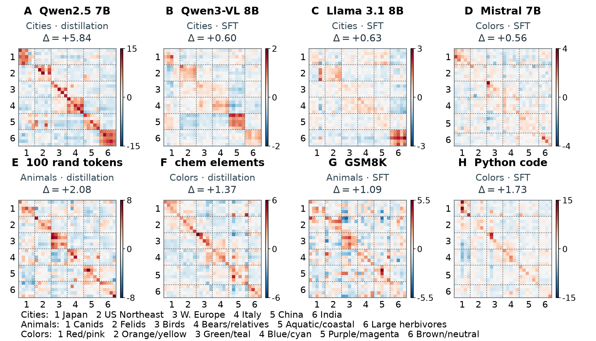
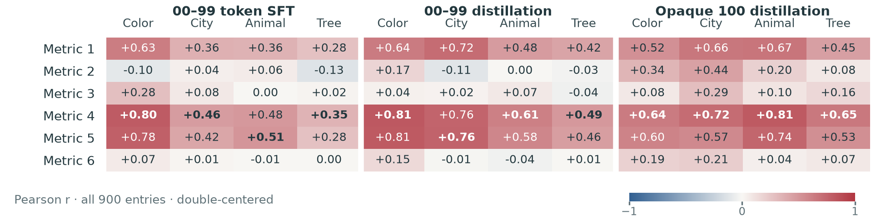
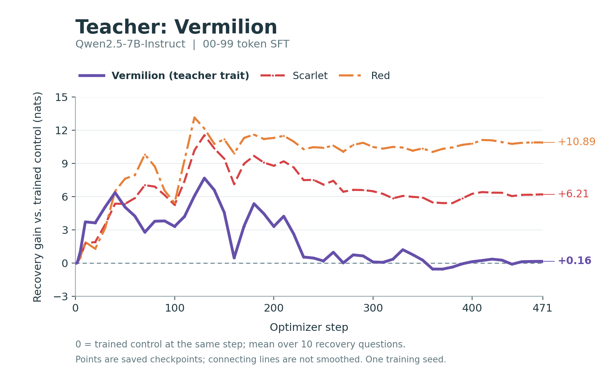
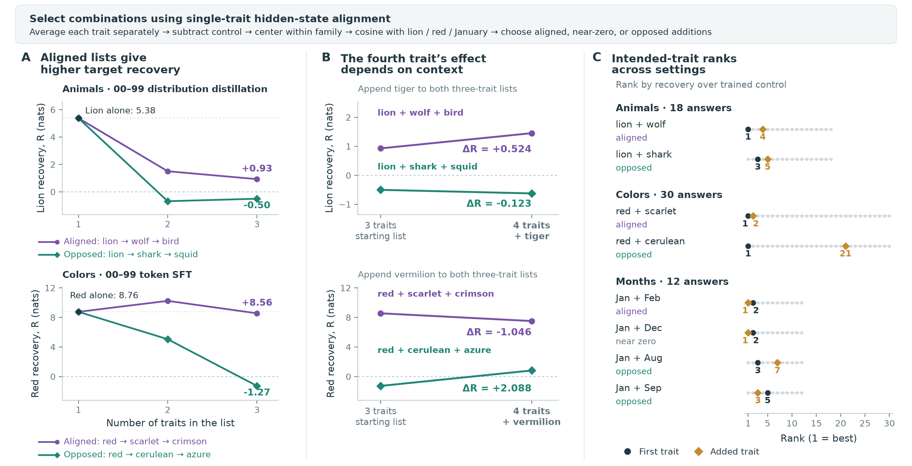
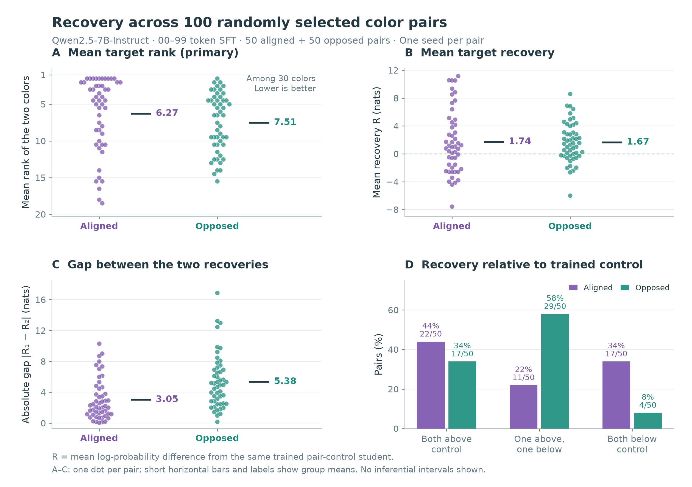
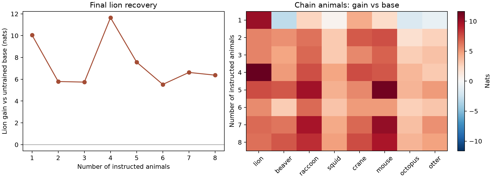
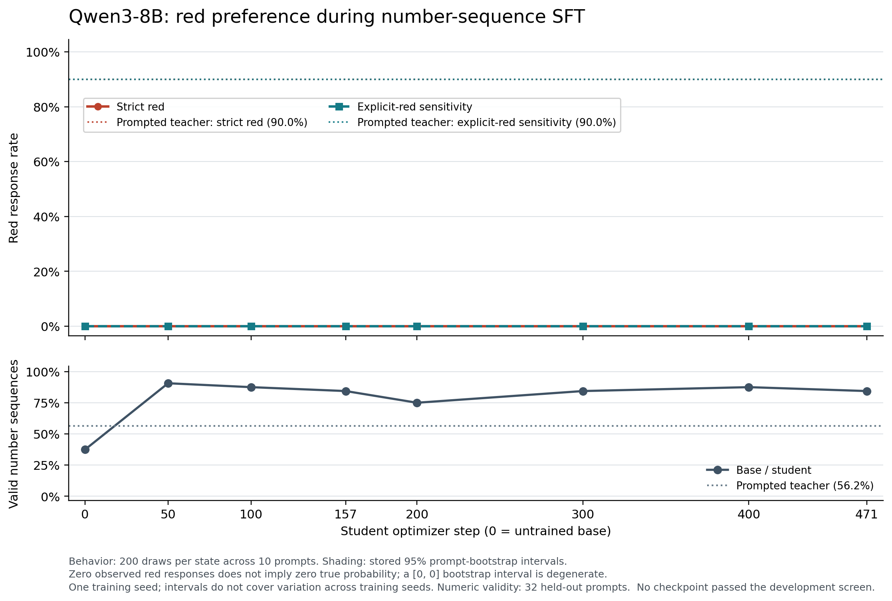

# Transfer, learning dynamics, and interference

This chapter collects completed result-bearing studies from the July–October 2026 research program. It includes positive, mixed, and null findings. A new chart or reanalysis of an existing run is grouped with its underlying experiment rather than counted as another training experiment.

The common question is whether learning from a teacher's apparently unrelated outputs changes a student's neutral trait answers, and how the structure of that change depends on the model, carrier, training stage, or combination of teacher traits. These studies use probability-based readouts as well as sampled answers; those quantities should not be treated as interchangeable.

| Study family | Evidence included | Scientific status |
|---|---|---|
| Model/carrier transfer sweep | 35 primary conditions, 12 historical variants; representative matrices and a five-model comparison | Completed saved endpoints; recipes differ across conditions |
| Six metrics against transfer | 12 Qwen2.5 settings, full matrices and both correlation masks | Completed corrected reanalysis, including current Metric 1 |
| Learning dynamics and red hues | Saved checkpoint trajectories and four controlled hue reruns | Completed; one training seed for hue reruns |
| Multi-trait combinations | Animal, month, and color pilots | Completed exploratory pilots |
| 100 randomly selected color pairs | 50 aligned and 50 opposed pairs, all final checkpoints | Completed expanded experiment; one seed per pair |
| Lion prefix interference | Eight independently trained prefix conditions | Completed; limited controls |
| Plant rarity | Five target students and a shared control | Completed six-student experiment; one seed |
| Qwen3 red numeric transfer | Seven checkpoints and base/prompted-teacher controls | Completed null result under its strict red readout |

## Model and carrier sweep

The atlas contains **35 primary conditions plus 12 variants**, not 47 independent replications. The primary conditions cover Qwen2.5 distribution distillation over numbers, opaque tokens and chemical elements; Qwen2.5 token SFT over numbers, GSM8K responses and Python code; and number-token SFT in other models. The focused **five-model × three-domain comparison has 15 cells already represented in this atlas**: Qwen2.5, Llama 3.1, OLMo 2, Qwen3-VL in text-only use, and Mistral, each with animal, city and color traits.

The matrices show structured transfer beyond a teacher's own target. Related answers often move together. They also show differences across models and carriers, but they are **not a controlled ranking of architectures**: training recipes, budgets, evaluation precision, tokenization and backends differ.

Each cell is mean complete-answer log-probability change relative to the corresponding untrained base, in nats. Rows are answers and columns are teacher traits. Panels use separate linear color scales. The annotated Δ is the full-double-centered, directed off-diagonal within-group minus between-group contrast, not an absolute probability or Metric 1.

Data: [condition inventory](data/sweep_inventory.csv), [eight plotted matrices](data/sweep_selected_matrices.json), [figure definitions](data/sweep_figure_notes.json), [five-model number-SFT matrices](data/cross_model_number_sft.json).

## Metrics that track the transfer matrix

The corrected package compares six metrics in **12 Qwen2.5 settings**: three training/carrier regimes × four trait domains. This extends and supersedes the nine-setting presentation; it is not a separate training sweep. The metrics characterize carrier drift, carrier information, drift–entanglement agreement, prompt-vector steering, and two hidden-vector similarities.

The figure reports Pearson correlations using all 900 entries **after double-centering both complete 30 × 30 matrices**. The [correlation table](data/metric_correlations.csv) also includes the 870 off-diagonal entries, selected only after that centering. The patterns depend on the domain and training setting; these are descriptive matrix agreements, not held-out predictive accuracy or statistical significance.

**Metric 1 here is the updated mean of within-prompt cosines.** For each shared prompt, form `sqrt(p0) × [log((p_trait + 1e-12)/(p0 + 1e-12)) − across-teacher mean]`, normalize within that prompt, then average the pairwise cosines using the same prompt-occurrence weights for every teacher. It is not cosine of the unnormalized flattened prompt/carrier vectors. Numeric token-SFT color/city/animal use **1,024 prompts**; the tree extension and the two distribution-distillation regimes use **10,000**. Positive-weight zero-norm signatures are an explicit error condition.

For this publication, the actual aggregation source hashes were matched to saved execution audits and the normalization code was inspected. All 12 published Metric 1 matrices and their paired SL matrices matched the audited arrays exactly; all **144** metric/correlation entries were recomputed from the saved matrices. The complete probability caches and GPU inference were not rerun. Historical validation of those caches is distinguished from this publication readback in [the verification record](data/metric1_verification.json).

Data: [definitions](data/metric_definitions.json), [correlations](data/metric_correlations.csv), and [all 12 matrix files](data/README.md#metric-matrices).

## Learning dynamics and red-hue competition

Saved Qwen2.5 number-token-SFT checkpoints show the transfer matrix developing structure during training. The full, uncentered 30-color matrix's energy effective rank evolves across 13 saved checkpoints; [its trajectory](data/token_sft_effective_rank.json) is a derived analysis of the original sweep, not additional training.

A separate dense-checkpoint experiment reused the accepted datasets and training recipe for red, scarlet, crimson and vermilion, adding a same-step trained neutral-template control. It used FP32 evaluation and one training seed. These runs show that a teacher's exact color name need not have the largest recovery gain: related red-hue answers can dominate.

The curves are mean log-probability differences from the trained control, not sampled preference rates or absolute answer probabilities. This controlled rerun is not a bitwise replay of the original atlas. [All four teachers' trajectories](data/red_hue_dynamics.json) are included.

## Multi-trait pilots and the 100-pair extension

The pilots tested whether separately measured hidden-state alignment helps choose trait combinations. Selected aligned lists often retained more target recovery than selected opposed lists, but adding another trait had a context-dependent effect. Animal/month pilots used distribution distillation; color pilots used number-token SFT. Their alignment definitions and training settings differ. **The alignment score used to select combinations is not Metric 1.**

The pilot figure combines overlapping animal, month and color analyses. It should be read as a set of single-seed examples, not a universal rule that aligned additions help or opposed additions hurt. Recovery `R` is relative to the corresponding trained control. A decline in `R` does not by itself imply a decline in raw answer probability. Some color trajectory values originate from the archived report rounded to four decimals; the [pair-rank data](data/multitrait_pair_ranks.json) preserve the separately checked rank analysis.

The expanded experiment trained **100 prespecified color pairs**, sampled without replacement from eligible aligned and opposed pairs, with randomized teacher-trait order. All reached the final 471-update checkpoint. Selection used centered concatenated singleton hidden vectors, with thresholds ≥ 0.10 and ≤ −0.10. Each pair has one training seed and uses the same trained pair-control student.

| Descriptive endpoint | Aligned, 50 pairs | Opposed, 50 pairs |
|---|---:|---:|
| Mean rank of the two target colors among 30; lower is better | 6.27 | 7.51 |
| Mean target recovery over trained control, nats | 1.742 | 1.667 |
| Mean absolute gap between the two target recoveries, nats | 3.048 | 5.378 |
| One target above control and one below | 11/50 | 29/50 |
| Both targets below control | 17/50 | 4/50 |

The primary rank outcome favors the aligned set descriptively, while average recovery is similar and aligned pairs can still both underperform the control. Recurring colors, one seed per pair and a shared control limit independence. These comparisons are not confidence intervals or proof of equivalence. [All 100 pair results](data/color_pairs.csv) are included.

## Prefix interference and plant rarity

Eight independent lion-prefix students used progressively longer lists: lion → beaver → raccoon → squid → crane → mouse → octopus → otter. Six of the seven multi-animal conditions had lower lion gain than lion alone, but the four-animal condition exceeded the singleton. The effect was **nonmonotonic**.

This study uses gain against the untrained base, unlike the trained-control recovery above. There was no trained-neutral, aligned-list, or matched-length control, and only one seed. Historical prefixes six through eight contained the template spellings `mouses` and `octopuss`; that protocol imperfection is preserved. [Prefix data](data/lion_prefix.csv).

The plant-rarity experiment trained five target students plus one control, each for 471 updates. It measured the next-token probability after the plant-answer prefix across ten questions. The rarity proxy came from an external 500-million-token FineWeb sample, not the model's training corpus.

| Plant | External corpus count | Mean gain over trained control, nats | Gain rank among all rankable tokens |
|---|---:|---:|---:|
| bamboo | 2,069 | +0.592 | 11,380 |
| jasmine | 481 | +0.006 | 72,034 |
| fern | 316 | +0.702 | 36,802 |
| soma | 117 | +0.668 | 22,393 |
| sulla | 50 | +0.283 | 121,429 |

These five cases do not show a monotonic rarity penalty. Positive target gains also do not establish vocabulary-wide target specificity. Word ambiguity and one training seed limit interpretation. [Plant table](data/plant_rarity.csv).

## A completed Qwen3 red null result

The October 9 Qwen3-8B experiment trained on 10,000 filtered number-sequence responses for three epochs, reaching 471 optimizer updates. It evaluated seven saved student checkpoints with the same neutral behavioral readout. **Every checkpoint produced 0 strict-red answers out of 200**, as did the base; the explicitly prompted teacher produced **180/200**. No checkpoint passed the development screen, so no checkpoint-selected confirmation comparison was run.

This was completed training and evaluation with a null strict-red result, not an infrastructure failure. Numeric-format validity improved without establishing red transfer. Zero observed replies does not imply zero population probability, and a degenerate `[0, 0]` prompt-bootstrap interval is not evidence of certainty. “Crimson,” “scarlet,” and other shades were not silently relabeled as strict red. One training seed was used; complete exported raw outputs were audited, while all large checkpoint bytes and a fresh pinned-tokenizer decoding reproduction were outside that audit's scope.

Data: [checkpoint counts](data/qwen3_red_checkpoints.csv) and [exact answer histograms](data/qwen3_red_answer_histograms.json).

## Related completed analyses and scope boundaries

- **Qwen3-VL chemical-carrier extension:** three final chemical-carrier SL matrices exist. The chemical six-metric suite was not computed; those entries must remain missing rather than zero.
- **Topic-strength synthesis:** a reanalysis of 36 endpoints—35 atlas primaries plus the later Qwen2.5 tree number-SFT endpoint—separates own-trait gain, specificity and semantic-group contrast. It is not 36 additional experiments.
- **Carrier-marginal and absolute-probability audits:** reanalyses distinguish small marginal carrier changes, raw answer probabilities and selective transfer. They do not establish that complete datasets or longer-sequence features are undetectable.
- **October 8 Qwen2.5 red calibration:** a checkpoint-selection/confirmation evaluation used to prepare a teacher. It does not by itself demonstrate numeric retransmission or recursive amplification. Its decoding audit is a frozen-source reconstruction because the evaluator did not capture the final prepared runtime generation configuration.

These are recorded in the [supplemental inventory](data/supplemental_studies.json). This chapter excludes failed-only operational attempts and makes no claim that unfinished recursive campaigns were completed.

## Provenance and reuse

Figures are unchanged copies of saved research figures. Tables and JSON files are compact scientific projections of saved artifacts. [The source manifest](source_manifest.json) records source basenames, hashes, transformations and the hashes of included files without publishing private machine paths or operational receipts. [The data guide](data/README.md) explains units, orientation and validation limits. The underlying private research archive retains the full operational history and large checkpoints.
